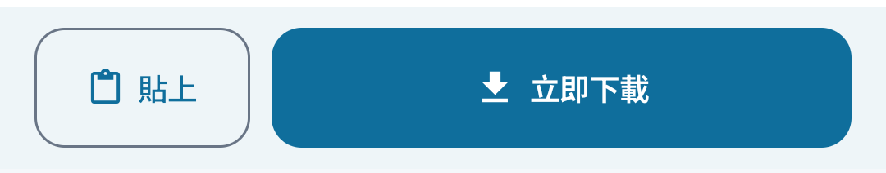

<p align="center"></p>

<h1 align="center">Social Downloader</h1>

<p align="center"><b>簡單下載，就該如此。</b><br>Share. Download.</p>

<p align="center"><a href="https://github.com/JJptt1980/SocialDownloader-releases/releases/latest"><b>下載最新版 APK</b></a></p>

<p align="center"><a href="https://ko-fi.com/jjptt1980"></a></p>

一個只做一件事的 Android App：把公開影片存回你的手機。

## 怎麼用

- **分享**：在其他 App 按「分享」，選「用 Social Downloader 下載」。在背景完成，通知列顯示進度。
- **貼上**：複製連結，打開 App（會自動貼上），按「立即下載」。

<p align="center"></p>

## 特色

- 解析在手機本機完成，不經第三方伺服器
- 影音分開時在手機上無損合併，最高 1080p
- 失敗會寫出原因，可一鍵複製除錯資訊
- App 內檢查並安裝新版本，安裝前核對簽章

## 相容性

Facebook、Threads、X 的公開影片。Instagram 部分內容需要在 App 內選擇登入。僅限公開內容。

## 安裝

1. 從 [Releases](https://github.com/JJptt1980/SocialDownloader-releases/releases/latest) 下載 `SocialDownloader-x.y.z-release.apk`。
2. 在手機上打開檔案，依提示允許「安裝不明應用程式」。
3. 需要 Android 10 以上、64 位元 ARM（arm64-v8a）手機。

之後在 App 頁面最下方按「檢查 App 更新」即可升級。

## 簽章

每個版本都用同一把金鑰簽章。App 內更新只會安裝簽章相同、版本較新的 APK。

簽章憑證 SHA-256：
`4d250262c9d4a238eb92429135aceed4bb5301bfce64d1226732e3a3935c8323`

自行核對：

```bash
apksigner verify --print-certs SocialDownloader-x.y.z-release.apk
```

## 關於這個 repository

這裡只放已簽章的 release APK 與說明，App 內更新會讀取這裡的最新版本。

---

<sub>僅下載你擁有或已獲授權保存的內容。Social Downloader 與任何社群平台無關聯，平台名稱僅用於說明相容性。</sub>
